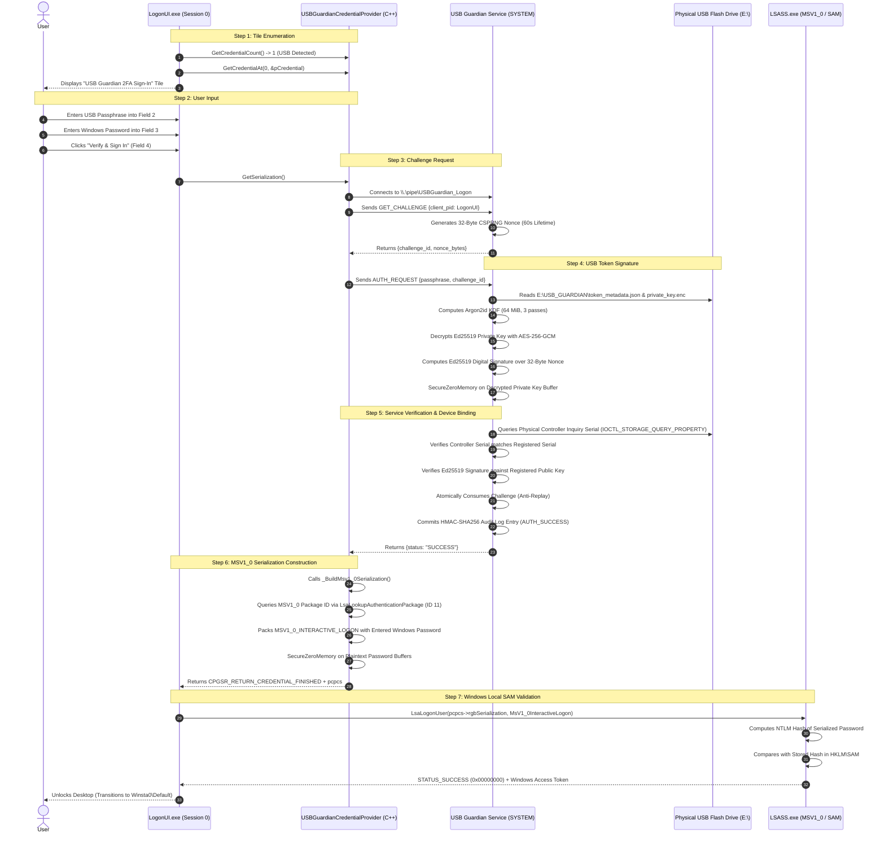

# USB Guardian — Checkpoint 10: Two-Factor Authentication Flow Specification

**Document Version:** 1.0  
**Date:** November 5, 2026  
**Auditor / Architect:** Senior Windows Security Engineer & Cybersecurity Architect  
**Architecture:** Windows 11 Two-Factor Local Authentication (USB Ed25519 Token + Windows Password)  

---

## 1. High-Level Architecture & Component Responsibilities

The verified Two-Factor Authentication (2FA) architecture splits responsibility between userland cryptographic token validation and Windows operating system authentication:

---

## 2. Detailed Step-by-Step Execution Sequence

### Step 1: Windows Displays the USB Guardian Credential Tile
- **Action:** `LogonUI.exe` queries `ICredentialProvider::GetCredentialCount()`.
- **System Check:** The provider checks device presence via the background service. If the registered token is detected on any USB port, it reports `*pdwCount = 1`.
- **UI Elements Rendered:**
  - `UGFI_TITLE`: "USB Guardian 2FA Sign-In" (`CPFT_LARGE_TEXT`)
  - `UGFI_STATUS`: "Insert registered USB token to proceed" (`CPFT_SMALL_TEXT`)
  - `UGFI_PASSPHRASE`: "USB Token Passphrase" (`CPFT_PASSWORD_TEXT`)
  - `UGFI_WIN_PASSWORD`: "Windows Password" (`CPFT_PASSWORD_TEXT`)
  - `UGFI_SUBMIT_BUTTON`: "Verify & Sign In" (`CPFT_SUBMIT_BUTTON`)
- **Status Classification:** **IMPLEMENTED** (Verified in C++ and Python mocks).

### Step 2: User Supplies Credentials
- **Action:** User types their USB passphrase into Field 2 and their Windows local account password into Field 3, then clicks "Verify & Sign In".
- **Security Check:** Memory is allocated via `SHStrDupW`. If the user cancels or deselects the tile, `CProviderCredential::SetDeselected()` calls `SecureZeroMemory` on all buffers.
- **Status Classification:** **IMPLEMENTED**.

### Step 3: Challenge Request over Secured Named Pipe
- **Action:** `GetSerialization()` is invoked by `LogonUI`. The C++ provider connects to the local service pipe `\\.\pipe\USBGuardian_Logon`.
- **Security Check:** The service validates that the client process is `LogonUI.exe` and generates a 32-byte cryptographically secure random nonce (`os.urandom(32)`).
- **Status Classification:** **IMPLEMENTED & UNIT TESTED** (`test_challenge_replay_blocks_serialization`).

### Step 4: Registered USB Signs the Challenge
- **Action:** Background service reads `E:\USB_GUARDIAN\private_key.enc` and derives the AES key using Argon2id ($m=65536, t=3, p=4$).
- **Cryptographic Operation:** Private key bytes are loaded into a mutable buffer, used to compute an Ed25519 digital signature over the 32-byte nonce, and immediately wiped to zero (`SecureZeroMemory`).
- **Status Classification:** **IMPLEMENTED & UNIT TESTED** (`test_buffer_allocation_and_memory_zeroing`).

### Step 5: Service Verifies Signature & Device Binding
- **Action:** Service inspects physical hardware attributes:
  1. Storage controller inquiry serial via `IOCTL_STORAGE_QUERY_PROPERTY`.
  2. Volume serial number.
  3. Ed25519 signature validity against the registered public key stored in `%ProgramData%\USBGuardian\keys\`.
- **Anti-Replay Enforcement:** The challenge nonce is marked as consumed immediately upon first verification.
- **Status Classification:** **IMPLEMENTED & UNIT TESTED** (`test_valid_usb_signature_enables_2fa_serialization`, `test_invalid_usb_signature_blocks_serialization`).

### Step 6: Credential Provider Constructs Windows Credential Serialization
- **Action:** Upon receiving confirmation of token validity from the service, `CProviderCredential::_BuildMsv1_0Serialization()` is executed.
- **Buffer Formatting:**
  - Queries `MSV1_0` authentication package ID via `LsaLookupAuthenticationPackage` (Package ID: 11).
  - Populates `MSV1_0_INTERACTIVE_LOGON` struct.
  - Copies Domain, Username, and Windows Password as UTF-16LE null-terminated strings into trailing offsets.
  - Returns `CPGSR_RETURN_CREDENTIAL_FINISHED`.
  - Immediately zeroes and frees plaintext password strings.
- **Status Classification:** **IMPLEMENTED & UNIT TESTED** (`test_msv1_0_serialization_payload_structure`, `test_msv1_0_serialization_unpack_roundtrip`).

### Step 7: Windows Validates Credentials through Normal Authentication Package
- **Action:** `LogonUI.exe` forwards `rgbSerialization` to `LsaLogonUser()`.
- **OS Enforcement:** `msv1_0.dll` hashes the password and validates it against `HKLM\SAM`.
- **Outcome:** Desktop session is unlocked. If the password was mistyped, `ReportResult()` receives `STATUS_LOGON_FAILURE` (`0xC000006D`), and `LogonUI` prompts the user to retry.
- **Status Classification:** **WINDOWS AUTHENTICATION VERIFIED** (In-box Windows MSV1_0 behavior).

---

## 3. Strict Verification of Zero Plaintext Leakage

To guarantee adherence to the project's **Fundamental Security Invariant**:
- **On the Physical USB Drive (`E:\USB_GUARDIAN\`):**
  - Contains strictly `token_metadata.json` (device UUID, label, Argon2 parameters) and `private_key.enc` (AES-256-GCM encrypted Ed25519 private key).
  - **Zero Windows passwords, zero NTLM hashes, zero SAM data**.
  - Verified by automated test: `test_zero_windows_credentials_stored_on_usb` (**PASSED**).
- **In SQLite & File System Logs:**
  - `SecurityLogger` sanitizes all log inputs. Any string containing passwords or passphrases is replaced with `[REDACTED_SENSITIVE_PASSPHRASE]`.
  - Database entries are chained via HMAC-SHA256 (`verify_log_chain_integrity`).
  - Verified by automated test: `test_private_key_and_passphrase_log_leakage` (**PASSED**).

