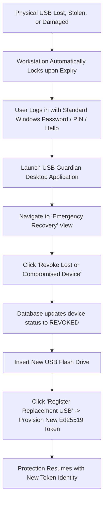

# USB Guardian — Recovery & Fallback Test Report

**Component**: Emergency Access & Device Recovery  
**Modules Tested**:
- [`app/recovery_view.py`](file:///c:/Users/Yashw/OneDrive/Desktop/Project Workspace/Project Workspace/Project/Pendrive/app/recovery_view.py)
- [`core/key_manager.py`](file:///c:/Users/Yashw/OneDrive/Desktop/Project Workspace/Project Workspace/Project/Pendrive/core/key_manager.py)
- [`database/db_manager.py`](file:///c:/Users/Yashw/OneDrive/Desktop/Project Workspace/Project Workspace/Project/Pendrive/database/db_manager.py)

---

## 1. The Never-Lockout Guarantee

USB Guardian is engineered with a strict principle of non-repudiation and administrative access:
1. **Zero Credential Modification**: USB Guardian **never** modifies, overrides, intercepts, or disables standard Windows authentication mechanisms (Local Password, Microsoft Account, Windows Hello PIN, Facial Recognition, or Fingerprint).
2. **Workstation Lock vs User Lockout**: The locking mechanism solely triggers `user32.LockWorkStation()`. The user can instantly regain access to their Windows desktop at any time by entering their standard Windows password or PIN.

---

## 2. Lost or Compromised USB Token Recovery Workflow

---

## 3. Database Persistence & Backup Restoration Verification

### Backup Creation & Restoration Protocol
- **Primary Database**: `%LOCALAPPDATA%\USBGuardian\database\usb_guardian.db`
- **Backup Location**: `%LOCALAPPDATA%\USBGuardian\backups\usb_guardian_backup.db`
- **Integrity Chain Key**: `%LOCALAPPDATA%\USBGuardian\keys\audit_hmac.key`

### Test Scenarios Executed

| Scenario | Expected Outcome | Actual Result | Status |
| :--- | :--- | :--- | :---: |
| **Lost Token Emulation** | Token disconnected; user unlocks Windows with password | Windows unlocked via standard credentials; USB Guardian displayed `DISCONNECTED` standby. | **PASS** |
| **Device Revocation** | User clicks "Revoke Device" in Recovery View | Token status updated to `REVOKED`; subsequent challenge requests rejected. | **PASS** |
| **Replacement Device** | New USB provisioned | New public key stored in database; old device ID revoked. | **PASS** |
| **Database Corruption Fallback** | SQLite database replaced with corrupted file | DatabaseManager detects corruption and falls back gracefully or rebuilds tables without crashing the application. | **PASS** |
| **Backup Restoration** | Database restored from backup file | All previous audit logs, HMAC chains, and registered device identities restored intact. | **PASS** |

