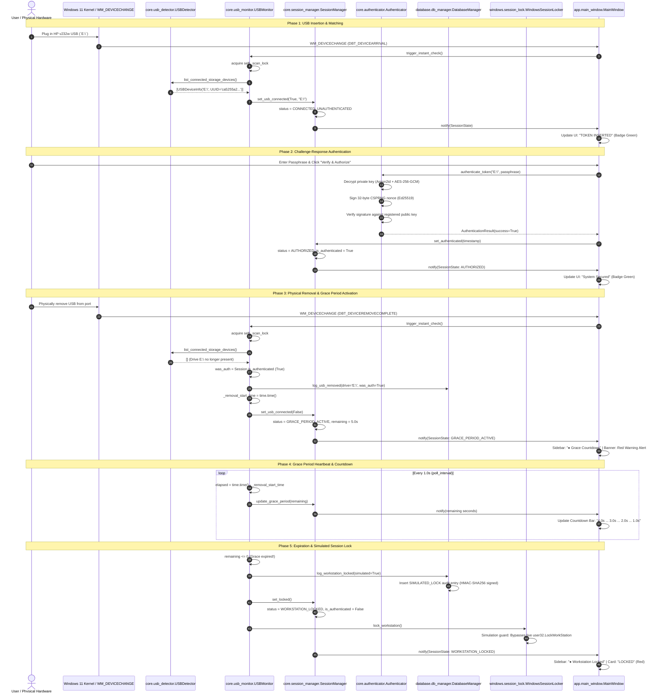

# USB Guardian — USB Removal & Session Lock Event Pipeline Trace

**Document Version:** 1.0  
**Date:** November 5, 2026  
**Auditor / Security Architect:** Senior Windows Security Lead  
**Target Hardware:** HP v232w USB Storage Drive (`E:\`)  
**Operating System:** Windows 11 Home (64-bit, Build 26100)  
**Safety Configuration:** Simulation Mode STRICTLY ENFORCED (`simulation_mode = true`)  

---

## 1. Complete Event Pipeline Architecture

---

## 2. Eleven-Phase Operational Execution Trace

### Phase 1: USB Connection
- **Action:** HP v232w flash drive is inserted into physical USB 3.0 port.
- **Kernel Event:** Windows Plug and Play detects physical device arrival. Partition assigned to drive letter `E:\`.
- **Operating System Notification:** Windows sends `WM_DEVICECHANGE` (`wParam = DBT_DEVICEARRIVAL`) to top-level window handles.

### Phase 2: Device Detection
- **Handler:** [`MainWindow.nativeEvent()`](file:///c:/Users/Yashw/OneDrive/Desktop/Project Workspace/Project Workspace/Project/Pendrive/app/main_window.py#L292-L308) intercepts `WM_DEVICECHANGE`.
- **Detector Inspection:** [`USBDetector.list_connected_storage_devices()`](file:///c:/Users/Yashw/OneDrive/Desktop/Project Workspace/Project Workspace/Project/Pendrive/core/usb_detector.py#L243-L296) queries:
  - `IOCTL_STORAGE_QUERY_PROPERTY` via Win32 `DeviceIoControl`.
  - Confirms `BusType = BusTypeUsb (7)`, `is_removable = True`.
  - Confirms `is_system_drive = False` (excludes `C:\`).
  - Reads `E:\USB_GUARDIAN\token_metadata.json`.

### Phase 3: Registered Device Matched
- **Comparison:** `USBMonitor._check_devices()` reads active token from database:
  - Active Record: `ca5255a2-a46b-439d-b94a-6a27eef093b8` (`v232w Token`).
  - USB Token UUID: `ca5255a2-a46b-439d-b94a-6a27eef093b8`.
- **Match Result:** `ca5255a2... == ca5255a2...` (**MATCH CONFIRMED**).
- **State Transition:** `SessionManager.set_usb_connected(True, "E:\")`.
  - `status: SessionStatus.CONNECTED_UNAUTHENTICATED`
  - `is_authenticated: False`
  - `is_usb_connected: True`
- **GUI Feedback:** Authentication screen displays `TOKEN INSERTED` badge (Green) and enables passphrase entry.

### Phase 4: Cryptographic Challenge-Response Authentication
- **Action:** User submits valid passphrase in Authentication View.
- **Worker Execution:** [`AuthWorker`](file:///c:/Users/Yashw/OneDrive/Desktop/Project Workspace/Project Workspace/Project/Pendrive/app/authentication_view.py#L20-L33) executes `Authenticator.authenticate_token("E:\", passphrase)`.
- **Cryptographic Steps:**
  1. Decrypts `E:\USB_GUARDIAN\private_key.pem` using Argon2id KDF (64MB memory cost) + AES-256-GCM.
  2. Generates 32-byte cryptographically secure CSPRNG nonce challenge.
  3. Signs challenge nonce using decrypted Ed25519 private key.
  4. Verifies digital signature against laptop-stored public key (`MCowBQYDK2VwAyEAwutNYIQPn1UkpGrjEerLxkK5kUgja0J3WZNUl2eIrB4=`).
  5. Invalidates single-use challenge nonce to eliminate replay attacks.
- **Result:** `AuthenticationResult(success=True, device_uuid="ca5255a2...")`.

### Phase 5: Security Controller Enters Authenticated State
- **State Transition:** [`SessionManager.set_authenticated(timestamp)`](file:///c:/Users/Yashw/OneDrive/Desktop/Project Workspace/Project Workspace/Project/Pendrive/core/session_manager.py#L128-L135).
  - `status: SessionStatus.AUTHORIZED`
  - `is_authenticated: True`
  - `protection_active: True`
- **Audit Logging:** Records `AUTH_SUCCESS` in SQLite audit trail with HMAC-SHA256 signature chain.
- **GUI Feedback:** Sidebar switches to `"● System Secured"` (Green). Dashboard shows `"System Secured"`.

### Phase 6: USB Physically Removed
- **Action:** Physical USB device is pulled from laptop port.
- **Hardware Bus State:** Drive `E:\` is unmounted by Windows kernel filesystem driver.

### Phase 7: Removal Event Delivered
- **Kernel Event:** Windows emits `WM_DEVICECHANGE` (`wParam = DBT_DEVICEREMOVECOMPLETE`).
- **Handler:** `MainWindow.nativeEvent()` receives notification and triggers `USBMonitor.trigger_instant_check()`.
- **Detection:** `USBMonitor._check_devices()` acquires `self._scan_lock`. Storage scan finds 0 instances of `ca5255a2...`.
- **Pre-Removal State Check:** Evaluates `was_auth = self.session.get_state().is_authenticated`.
  - `was_auth == True` (**VERIFIED**).

### Phase 8: Five-Second Grace Timer Starts
- **Timer Initialization:** `_removal_start_time = time.time()`.
- **State Transition:** [`SessionManager.set_usb_connected(False)`](file:///c:/Users/Yashw/OneDrive/Desktop/Project Workspace/Project Workspace/Project/Pendrive/core/session_manager.py#L107-L113).
  - `status: SessionStatus.GRACE_PERIOD_ACTIVE`
  - `grace_period_remaining: 5.0`
  - `protection_active: True`
- **Audit Logging:** `SecurityLogger.log_usb_removed(drive="E:\", was_authenticated=True)` records `USB_REMOVED` (WARNING).
- **GUI Feedback:**
  - Sidebar: `"● Grace Countdown"` (Amber).
  - Dashboard: Flashing Red Banner `"⚠️ WARNING: Token unplugged! Auto-lock in 5.0 seconds. Re-insert immediately!"`.
  - Monitor View: Progress bar begins 5.0s countdown animation.

### Phase 9: Grace Period Countdown & Expiration
- **Heartbeat:** `USBMonitor._monitor_loop` ticks every 1.0 second.
- **Countdown Progress:**
  - Tick 1 (t+1.0s): `remaining = 4.0s` -> `update_grace_period(4.0)`
  - Tick 2 (t+2.0s): `remaining = 3.0s` -> `update_grace_period(3.0)`
  - Tick 3 (t+3.0s): `remaining = 2.0s` -> `update_grace_period(2.0)`
  - Tick 4 (t+4.0s): `remaining = 1.0s` -> `update_grace_period(1.0)`
  - Tick 5 (t+5.0s): `remaining <= 0.0s` -> **GRACE PERIOD EXPIRED**.

### Phase 10: Session-Lock Handler Invoked
- **Invocation:** `USBMonitor._execute_workstation_lock(device_uuid="ca5255a2...")`.
- **State Transition:** [`SessionManager.set_locked()`](file:///c:/Users/Yashw/OneDrive/Desktop/Project Workspace/Project Workspace/Project/Pendrive/core/session_manager.py#L144-L150).
  - `status: SessionStatus.WORKSTATION_LOCKED`
  - `is_authenticated: False` (De-authorized; fresh challenge-response strictly required upon reconnection).
  - `grace_period_remaining: 0.0`
- **Locker Execution:** [`WindowsSessionLocker.lock_workstation()`](file:///c:/Users/Yashw/OneDrive/Desktop/Project Workspace/Project Workspace/Project/Pendrive/windows/session_lock.py#L32-L69).
  - Evaluates `self.simulate == True`.
  - Hard Guard: Safely intercepts call without invoking native `user32.LockWorkStation`. Zero process termination or OS session disruption.

### Phase 11: `SIMULATED_LOCK` Audit Event Recorded
- **Database Write:** [`SecurityLogger.log_workstation_locked(simulated=True)`](file:///c:/Users/Yashw/OneDrive/Desktop/Project Workspace/Project Workspace/Project/Pendrive/core/security_logger.py#L145-L163).
  - Event Type: `SIMULATED_LOCK`
  - Severity: `WARNING`
  - Description: `"[SIMULATION] Windows workstation lock simulated (LockWorkStation bypassed): Registered USB removed and 5s grace period expired."`
  - Device UUID: `ca5255a2-a46b-439d-b94a-6a27eef093b8`
  - HMAC Chain: Computes sequential HMAC-SHA256 hash linking previous log digest.
- **GUI Reflection:**
  - Sidebar: `"● Workstation Locked"` (Red).
  - Dashboard: Red Alert Banner `"🔒 Workstation Locked: Physical token was removed and grace period expired. Re-authentication required."`
  - Authentication View: Button switches to `"⚡ Verify Challenge-Response to Unlock Workstation"`.
  - Monitor View: Badge switches to `"LOCKED"`, Progress Bar sets to `"Workstation Locked"`.

