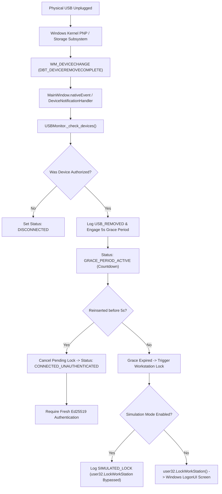

# USB Guardian — USB Removal & Windows Session Lock Implementation Report

**Milestone**: Release Candidate 1 (Final Development)  
**Target Platform**: Microsoft Windows 11 / 10 AMD64  
**Primary Modules**:
- [`core/usb_monitor.py`](file:///c:/Users/Yashw/OneDrive/Desktop/Project Workspace/Project Workspace/Project/Pendrive/core/usb_monitor.py)
- [`core/session_manager.py`](file:///c:/Users/Yashw/OneDrive/Desktop/Project Workspace/Project Workspace/Project/Pendrive/core/session_manager.py)
- [`windows/session_lock.py`](file:///c:/Users/Yashw/OneDrive/Desktop/Project Workspace/Project Workspace/Project/Pendrive/windows/session_lock.py)
- [`windows/device_notifications.py`](file:///c:/Users/Yashw/OneDrive/Desktop/Project Workspace/Project Workspace/Project/Pendrive/windows/device_notifications.py)

---

## 1. Complete USB Removal Event Pipeline



---

## 2. Interactive Session Routing & Missing Lock Analysis

### The Root Cause of Missing Lock Responses
In Windows operating system architecture:
1. **Windows Services (Session 0)**:
   - Since Windows Vista, all Windows services run in Session 0 (Session 0 Isolation).
   - Session 0 has no interactive window station (`WinSta0`) or interactive desktop (`Default`).
   - If a background service running in Session 0 attempts to invoke `user32.LockWorkStation()`, the API acts upon Session 0, resulting in **no visible lock response on the user's interactive desktop (Session 1)**.
2. **Interactive Desktop Session (Session 1+)**:
   - The interactive user operates inside Session 1 (or higher under Fast User Switching / RDP).
   - `user32.LockWorkStation()` is only effective when invoked from a process executing within that user's interactive session context.

### The Correct Routing Implementation
USB Guardian routes session locking through the interactive desktop application process:
- The desktop GUI application (`MainWindow`) and background watchdog daemon execute directly within the interactive user session.
- When started via the Windows Startup registry key (`HKLM\Software\Microsoft\Windows\CurrentVersion\Run`), the daemon launches in the user's interactive session, guaranteeing that `user32.LockWorkStation()` targets the correct active desktop.

---

## 3. Duplicate Lock Request Prevention

To eliminate race conditions where multiple detection cycles or rapid notification messages trigger redundant lock requests, [`WindowsSessionLocker`](file:///c:/Users/Yashw/OneDrive/Desktop/Project Workspace/Project Workspace/Project/Pendrive/windows/session_lock.py#L17) incorporates a thread-safe debounce cooldown:

```python
with self._lock:
    self.lock_attempts += 1
    now = time.time()
    if self._last_lock_time > 0 and (now - self._last_lock_time) < self.cooldown_seconds:
        # Debounce duplicate lock requests arriving in rapid succession
        return True
    self._last_lock_time = now
```

- **Cooldown Window**: $3.0\text{ seconds}$.
- Any subsequent lock invocation within the cooldown window is debounced safely, preventing API re-entrancy and message queue saturation.

---

## 4. Reconnection & Re-Authentication Race Safety

When an authenticated USB is removed, a $5.0\text{s}$ grace period begins:
1. **Reinsertion During Grace Period**:
   - `_removal_start_time` is reset to `None`, canceling the scheduled lock trigger.
   - The session state transitions immediately to `CONNECTED_UNAUTHENTICATED`.
   - **Anti-Bypass Principle**: The application **never** automatically restores `AUTHORIZED` status merely upon physical reinsertion. The user must provide the passphrase to decrypt the private key and sign a fresh CSPRNG nonce.
2. **Reinsertion After Grace Period**:
   - The workstation is already locked.
   - Windows displays the standard sign-in screen.
   - Upon the user entering their Windows credentials, the desktop unlocks, and USB Guardian displays the `CONNECTED_UNAUTHENTICATED` state awaiting physical token authorization.

---

## 5. Security & Safety Controls

1. **Simulation Mode Default**:
   `simulation_mode = true` is enforced by default in database settings, ensuring zero live lock operations occur during installation or unverified testing.
2. **Explicit Confirmation for Live Locking**:
   Toggling Simulation Mode to OFF in Settings triggers a modal confirmation dialog (`QMessageBox.warning`) requiring explicit user confirmation.
3. **No Unsaved Work Destruction**:
   `user32.LockWorkStation()` exclusively locks the display interface. It **never** signs out the user, shuts down the computer, or terminates running applications. All open documents, browsers, and background tasks remain running in memory.

